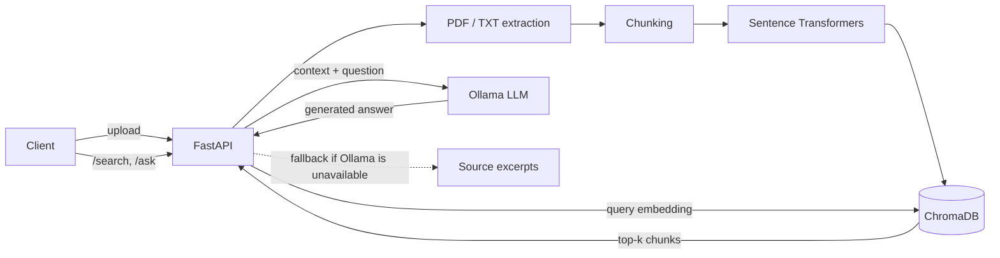

# DocuSearch

**A document Q&A API built on Retrieval-Augmented Generation (RAG).** Upload PDF or TXT files, search them semantically, and get answers grounded in the retrieved passages, with references to the source chunks. Generation runs on a local LLM through Ollama, so no document leaves your machine.


[](https://github.com/<your-username>/docusearch/actions)

## Table of contents

- [Features](#features)
- [Architecture](#architecture)
- [Tech stack](#tech-stack)
- [Quick start](#quick-start)
- [Configuration](#configuration)
- [API reference](#api-reference)
- [Testing and linting](#testing-and-linting)
- [Evaluation](#evaluation)
- [Limitations](#limitations)
- [Roadmap](#roadmap)

## Features

- **Ingestion**: PDF and TXT upload with file-size and extension validation.
- **Chunking**: overlapping text chunks to preserve context across boundaries.
- **Semantic search**: embeddings from `sentence-transformers/all-MiniLM-L6-v2`, stored in a persistent ChromaDB collection.
- **Grounded answers**: the `/ask` endpoint sends the retrieved passages and the question to a local Ollama model. If Ollama is unreachable, it returns the relevant source excerpts instead of a generated answer, and never fabricates one.
- **Developer experience**: interactive OpenAPI docs, explicit error handling, unit tests, linting with Ruff, CI on GitHub Actions, and a Docker Compose setup.

## Architecture



## Tech stack

| Layer | Technology |
| --- | --- |
| API | FastAPI, Uvicorn |
| Embeddings | Sentence Transformers (`all-MiniLM-L6-v2`) |
| Vector store | ChromaDB (persistent) |
| Generation | Ollama (optional, local) |
| Quality | pytest, Ruff, GitHub Actions |
| Packaging | Docker, Docker Compose |

## Quick start

### Option 1: Docker (recommended)

```bash
docker compose up --build
```

Open <http://localhost:8000/docs>. Compose also starts an Ollama service for answer generation. Pull a model once:

```bash
docker compose exec ollama ollama pull qwen2.5:3b
```

The embedding model is downloaded on first use inside the API container, and the vector database is persisted in a named volume.

### Option 2: Local (Python 3.11 recommended)

```bash
python -m venv .venv
source .venv/bin/activate        # Windows PowerShell: .venv\Scripts\Activate.ps1
pip install -r requirements.txt
uvicorn app.main:app --reload
```

Open <http://127.0.0.1:8000/docs>. The first document operation downloads the embedding model from Hugging Face, so the first run needs internet access and may take a few minutes.

To enable generated answers, install [Ollama](https://ollama.com) and pull a small model:

```bash
ollama pull qwen2.5:3b
```

## Configuration

| Variable | Description | Example |
| --- | --- | --- |
| `OLLAMA_URL` | Ollama server URL (defaults to the local instance) | `http://localhost:11434` |
| `OLLAMA_MODEL` | Model used for answer generation | `qwen2.5:3b` |

## API reference

| Method | Endpoint | Description |
| --- | --- | --- |
| `POST` | `/documents` | Upload and index a PDF or TXT file |
| `POST` | `/search` | Semantic search over indexed documents |
| `POST` | `/ask` | Answer a question using retrieved passages |
| `GET` | `/health` | Health check |

Full interactive documentation is available at `/docs` when the server is running.

**Index a document**

```bash
curl -X POST http://localhost:8000/documents \
  -F 'file=@sample.txt'
```

**Search**

```bash
curl -X POST http://localhost:8000/search \
  -H 'Content-Type: application/json' \
  -d '{"query": "How does the system handle errors?", "top_k": 3}'
```

**Ask a question**

```bash
curl -X POST http://localhost:8000/ask \
  -H 'Content-Type: application/json' \
  -d '{"question": "How does the system handle errors?", "top_k": 3}'
```

## Testing and linting

```bash
pytest -q
ruff check app tests
```

The current test suite covers text extraction and chunking. The same checks run automatically on every push through GitHub Actions.

## Evaluation

Retrieval quality is measured with Recall@3: the fraction of benchmark questions for which at least one expected source chunk appears in the top three results.

Planned benchmark: 15 to 20 questions with manually labeled expected chunks. Results will be published here once measured.

## Limitations

- Text-based PDFs only; scanned documents would require OCR.
- No authentication or multi-user isolation.
- Local embedding and LLM inference can require significant disk space and memory.
- Source references use filenames and chunk indices, not PDF page numbers.
- Retrieval and answer quality have not yet been evaluated on a benchmark.

## Roadmap

- [ ] Integration tests for the upload, search and ask workflow
- [ ] Retrieval benchmark and published Recall@3 results
- [ ] Authentication and rate limiting
- [ ] Page-level source references for PDFs
- [ ] OCR support for scanned documents
- [ ] Structured logging and monitoring
